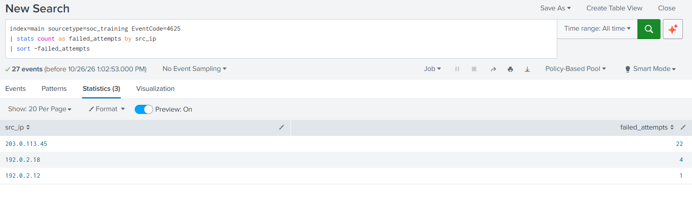
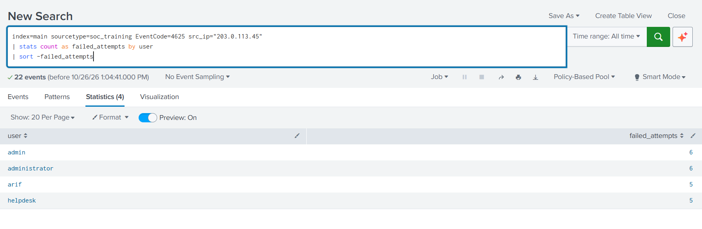
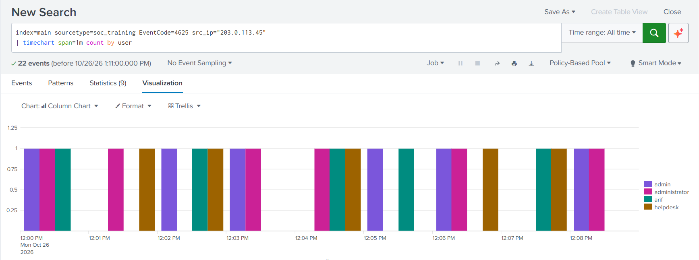
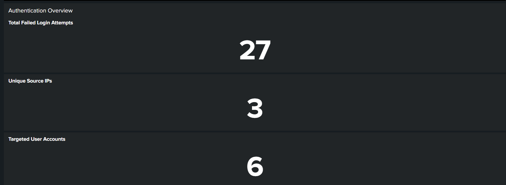
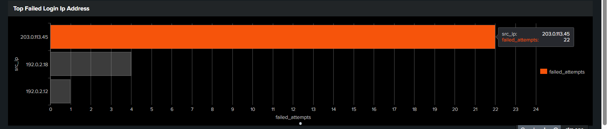
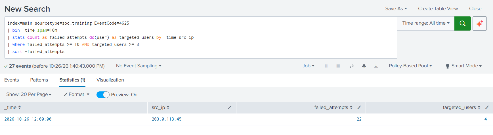
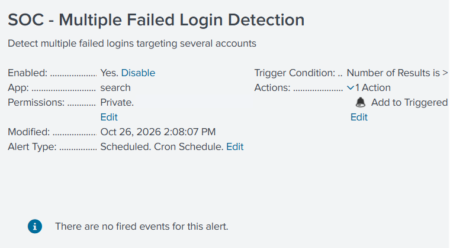

# Splunk Cloud SOC Homelab

Hands-on security operations (SOC) project using **Splunk Cloud Platform** to ingest **simulated Windows authentication logs**, investigate failed sign-ins, build a monitoring dashboard, and configure a scheduled detection alert.

> **Scope and integrity:** This is a **training lab**, not evidence of an actual intrusion or a live Windows monitoring deployment. The dataset contains synthetic Windows-style key-value events, not native Windows `.evtx` records. The scheduled alert was saved and enabled, but **no alert firing has been observed** at the time of documentation.

## Project objectives

- Learn Splunk's Search Processing Language (SPL) for security event analysis.
- Identify source IPs and user accounts with repeated failed logon events.
- Analyze authentication attempts over time and assess a possible multi-account password-guessing pattern.
- Create reusable dashboard panels and a scheduled detection rule.
- Document findings and supporting evidence using screenshots and reproducible search queries.

## Architecture

```text
Synthetic Windows-style authentication log (.log)
                    |
                 File upload
                    v
        Splunk Cloud Platform
          index = main
     sourcetype = soc_training
                    |
        Search & Reporting (SPL)
               /         \
              v           v
      SOC Dashboard   Saved Detection Alert
```

This implementation uses **manual file ingestion**. Splunk Universal Forwarder / live Windows Event Log ingestion is a **planned extension**, not part of the completed lab.

## Lab environment

| Component | Details |
|---|---|
| SIEM/log analytics | Splunk Cloud Platform — Search & Reporting |
| Data | 73 synthetic, Windows-style authentication events |
| Index | `main` |
| Sourcetype | `soc_training` |
| Event codes | `4624` (successful logon), `4625` (failed logon) |
| Dashboard | `SOC Secure Monitoring` |
| Scheduled alert | `SOC - Multiple Failed Login Detection` — configured and enabled; no firing observed |

## Investigation results

| Finding | Observed result |
|---|---:|
| Total events in sample file | 73 |
| Failed logon events (4625) | **27** |
| Successful logon events (4624) | 46 |
| Distinct source IPs with failed logons | **3** |
| Distinct usernames with failed logons | **6** |
| Failed logons from `203.0.113.45` | **22** |
| Distinct users targeted by that IP | **4** |

The IP `203.0.113.45` accounted for **22/27 (81.5%)** failed logons. Those 22 events appeared in the same 10-minute bucket in the lab search. Four accounts were targeted: `admin`, `administrator`, `arif`, and `helpdesk`.

The pattern warrants investigation as **possible multi-account password guessing**. The evidence **does not prove password spraying** (which requires additional information about how passwords were attempted), and no successful login from that same IP was observed in the sample data.

> `203.0.113.0/24` and `192.0.2.0/24` are reserved documentation IP address ranges. They do not identify real external attackers in this lab.

## Evidence and screenshots

### 1. Failed-login investigation



### 2. Usernames targeted by the selected source IP



### 3. Failed-login timeline



### 4. Authentication overview KPIs



### 5. Top failed-login source IPs



### 6. Threshold-based detection search



### 7. Scheduled alert configured



The alert status screenshot shows **no fired events**. A triggered-alert screenshot is not included because no alert triggering was demonstrated.

## Key SPL searches

All queries are saved as standalone files in [`queries/`](queries/). The lab source uses the `soc_training` sourcetype; adapt the index, sourcetype and field names for real Windows Event Log data.

**Count all failed logons**

```spl
index=main sourcetype=soc_training EventCode=4625
| stats count as total_failed_logins
```

**Rank sources by failed logons**

```spl
index=main sourcetype=soc_training EventCode=4625
| stats count as failed_attempts by src_ip
| sort -failed_attempts
```

**Analyze failed logons by username for one source**

```spl
index=main sourcetype=soc_training EventCode=4625 src_ip="203.0.113.45"
| stats count as failed_attempts by user
| sort -failed_attempts
```

**Threshold-based multi-account detection (the tested lab search)**

```spl
index=main sourcetype=soc_training EventCode=4625
| bin _time span=10m
| stats count as failed_attempts dc(user) as targeted_users by _time src_ip
| where failed_attempts >= 10 AND targeted_users >= 3
| sort -failed_attempts
```

This flags a 10-minute bucket when the **same source IP** has at least **10 failed attempts** targeting at least **3 distinct usernames**. For continuous alerting, review time windows, field normalization and false-positive handling before deploying on live data.

## Reproduce the lab

1. Create or sign in to a Splunk Cloud environment where file upload is permitted.
2. Upload [`data/splunk_soc_training.log`](data/splunk_soc_training.log) through **Settings → Add Data → Upload**.
3. Configure event breaks so each line is a separate event and verify automatic timestamp recognition.
4. Use `soc_training` as the sourcetype, and `main` as the index (or change the SPL queries to match your index).
5. Open **Search & Reporting**, select **All time**, and run the searches from `queries/`.
6. Build a dashboard with three single-value panels plus the timeline and IP bar chart.
7. Save the detection as a scheduled alert. The historical training file will **not** generate a new alert under a **Last 10 minutes** time range.

Additional details: [Lab setup notes](docs/lab-setup.md) and [SOC investigation report](docs/investigation-report.md).

## Current status and next steps

- [x] Upload and validate synthetic authentication data
- [x] Perform SPL-based failed logon investigation
- [x] Build `SOC Secure Monitoring` dashboard
- [x] Create and enable a scheduled detection alert
- [ ] Generate fresh test events and verify a triggered alert
- [ ] Install and configure Splunk Universal Forwarder in a personal Windows lab
- [ ] Collect real Windows Security Event Logs (with permission)
- [ ] Tune detections and document false-positive scenarios

## Safety and ethics

Use only sample data or systems you own / are explicitly authorized to monitor. Do not publish genuine authentication logs, credentials, internal IP addresses, personal data, or private Splunk Cloud access details.

## Skills practiced

`Splunk Cloud` · `SPL` · `SIEM` · `Security Log Analysis` · `SOC Investigation` · `Detection Engineering Fundamentals` · `Dashboards` · `Windows Authentication Events`
